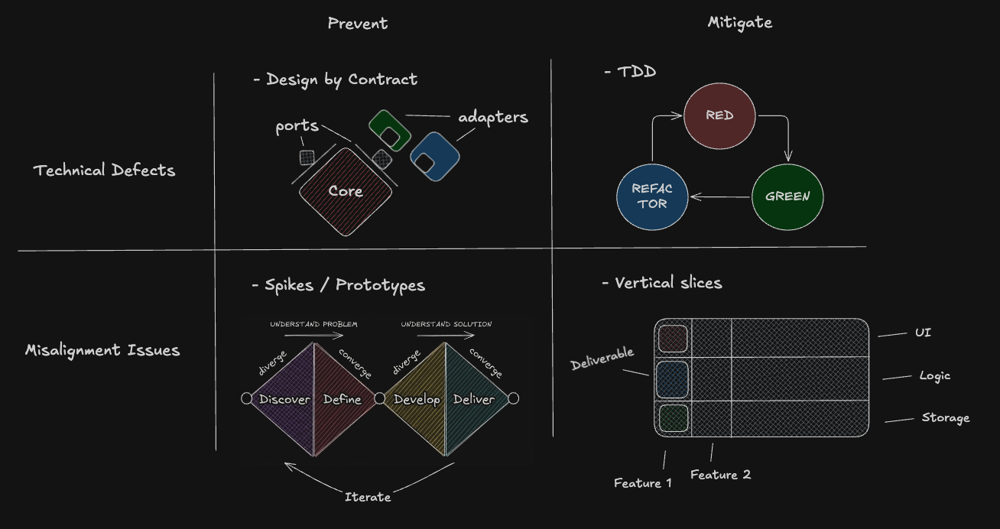
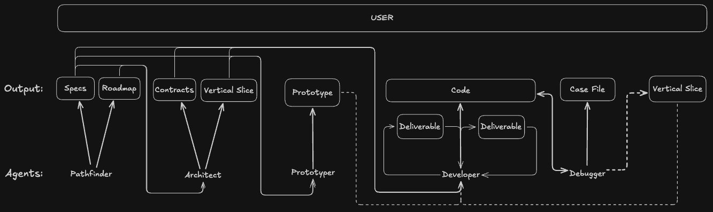

<div align="center">

# TeDDy

### The opinionated software engineering harness

<p align="center">
  <em>Because <b>you</b> should own the means of development</em>
</p>

[](https://pypi.org/project/teddy-cli/)
[](https://www.python.org/)
[](LICENSE)

```bash
uv tool install teddy-cli
```

<p align="center">
  
</p>

[Quickstart](#getting-started) &bull; [Workflow](#the-teddy-workflow) &bull; [Why TeDDy?](#why-not-just-use) &bull; [Architecture](#what-makes-teddy-special) &bull; [Video Walkthrough](https://www.youtube.com/watch?v=2j2fvRBGtag) &bull; [FAQ](#frequently-asked-questions)

</div>

---

## Motivation

The [2025 DORA report](https://dora.dev/research/2025/) found that AI adoption raises delivery throughput and product performance, but remains negatively related to delivery stability: code moves faster, but disproportionately more of it breaks. Any gains in raw speed are counterbalanced by increased effort needed for reviewing and reworking slop code to avoid technical defects and misalignment from compounding. Teams with fast feedback loops and loosely coupled systems see the most gain, while teams with inefficient processes and tight coupling see little or no benefit.

[Bain's 2026 Technology Report](https://www.bain.com/insights/the-missing-architecture-for-agentic-software-development-technology-report-2026/) reaches the same conclusion from the other side: AI has sped up coding, but that has shifted bottlenecks to review, governance, and software delivery. The limiting factor has shifted from the model to the connective architecture around it. Better models will not by themselves fix these emerging issues.

TeDDy addresses these bottlenecks by bringing proven engineering practices like **[Test-Driven Development](https://en.wikipedia.org/wiki/Test-driven_development), [Hexagonal Architecture](https://en.wikipedia.org/wiki/Hexagonal_architecture_(software)), and [Iterative & Incremental Delivery](https://en.wikipedia.org/wiki/Iterative_and_incremental_development)** directly into your agentic workflow, using only local plain text files that you can read, review, and change, with nothing hidden in a proprietary database or cloud service.

---

## Video Walkthrough

<p align="center">
  <a href="https://www.youtube.com/watch?v=2j2fvRBGtag">
    
  </a>
</p>

---

## Why Not Just Use...

<details>
<summary><strong>...Skill.md files?</strong></summary>

<br />

Skills sit on top of your harness's built-in system prompt. When instructions conflict, the harness prompt takes priority over your rules. Upstream updates also change that prompt over time, which can break your setup without warning. TeDDy instead splits the work across specialist agents with separate system prompts that you control directly. You can still use your existing skill files alongside them.

</details>

<details>
<summary><strong>...Spec-driven development?</strong></summary>

<br />

Spec-driven development requires you to define everything upfront before writing code. This is essentially the [waterfall model](https://en.wikipedia.org/wiki/Waterfall_model) under a new name, relying on the assumption that initial requirements will be completely accurate. That assumption rarely holds, as non-trivial systems always uncover edge cases and evolving requirements during development. TeDDy still uses specifications, but treats them as living documents within an iterative process more akin to [Agile](https://en.wikipedia.org/wiki/Agile_software_development), allowing the design to adapt as you build.

</details>

<details>
<summary><strong>...Automation?</strong></summary>

<br />

TeDDy integrates automated pre-commit hooks, local test suites, and CI/CD pipelines directly into the agent workflow. Even so, automated tests alone cannot prevent misalignment or verify intent. As [Bain's report](https://www.bain.com/insights/the-missing-architecture-for-agentic-software-development-technology-report-2026/) notes, speeding up code generation without redesigning the surrounding process does not compound gains; it just redistributes the pain to the slowest human checkpoint. TeDDy pairs these automated quality gates with a human-in-the-loop workflow mediated through specific Markdown documents across each phase of the software delivery lifecycle.

</details>

---

## What Makes TeDDy Special

1. **Markdown as the interface.** Inspired by [Obsidian](https://obsidian.md/)'s file-over-app philosophy, the file system is the interaction medium rather than an ephemeral chat window. Every turn produces explicit Markdown files (`input.md`, `plan.md`, `report.md`), while the built-in TUI provides an interactive review layer to inspect, edit, and approve actions before execution.
2. **Local-first architecture.** Inspired by the [UNIX philosophy](https://en.wikipedia.org/wiki/Unix_philosophy) of small, sharp tools, TeDDy runs entirely inside your existing workspace with no cloud dependencies, proprietary databases, or background telemetry. It integrates cleanly with standard developer environments, allowing your terminal, local Git hooks, and preferred editor to drive the workflow.
3. **Auditable by design.** Inspired by [Git](https://git-scm.com/)'s ledger model, every session maintains an immutable history of what the agent intended and what actually executed. Each plan enforces a structured rationale covering synthesis, justification, and expected outcomes, making agent reasoning fully traceable, searchable, and easy to parse with your own scripts for analysis.

---

## Why Working Code Is Not Enough

LLMs are pre-trained on next-token prediction and fine-tuned with reinforcement learning to solve discrete and well-defined tasks, making them effective at writing code that works in isolation, but poorly equipped to navigate uncertainty or keep code and intent aligned over time. LLMs are also evaluated and trained on generating the final solution in one shot instead of working iteratively and incrementally, which, if left unchecked, leads to defects compounding on top of each other over time.

Defects in software come in two kinds: technical defects, where <u>code matches your intent but breaks on edge cases or introduces bugs</u>, and misalignment, where the <u>code technically works but is not what you actually wanted</u>. Most coding harnesses do little to address either one, forcing teams to patch extra tools and components into their software development lifecycle just to keep code on track. TeDDy instead tackles both types of defects directly within the harness, preventing them before they happen and mitigating them as early as possible when they do.

For **technical defects**, TeDDy prevents structural failures through Design by Contract, enforcing Hexagonal Architecture through ports and adapters. To mitigate bugs during development, it uses a strict Test-Driven (Red-Green-Refactor) cycle to write tests first and commit code in small units to surface errors early.

For **misalignment**, TeDDy prevents building the wrong thing by using spikes and prototypes to de-risk uncertain solutions before committing to an architecture. During implementation, it mitigates drift by delivering features through small vertical slices. Specific Markdown documents mediate every phase transition, anchoring the agents and providing a high-level steering interface to keep humans in the loop.

<p align="center">
  
</p>

---

## The TeDDy Workflow

TeDDy breaks down the development process into distinct agents, each with a specific mandate. Their interaction is mediated through documents, letting you steer the project at a high level throughout.

<p align="center">
  
</p>

1. **Pathfinder:** Dissects goals from first principles to produce grounded roadmaps and milestones.
2. **Architect:** Enforces Ports & Adapters boundaries, defines component contracts, and decomposes features into vertical slices.
3. **Prototyper:** Validates behavioral scenarios in an isolated sandbox, refining specs and edge cases before implementation begins.
4. **Developer:** Delivers features one atomic deliverable at a time through a strict **Red-Green-Refactor** TDD cycle.
5. **Debugger:** Isolates root causes using Minimal Reproducible Examples (MREs) and verifies fixes in sandboxes before touching production code.
6. **Assistant:** Executes tactical chores, one-off scripts, and ad-hoc edits through a fast loop without enforcing strict methodology.

> [!NOTE]
> Each agent's prompt lives in `.teddy/prompts/` inside your project. You can inspect and tune existing agents or add your own. Updates will never overwrite these files automatically, ensuring your instructions remain stable and entirely under your control.

---

## Getting Started

### Prerequisites

- Python 3.11 or later
- `uv` (recommended) or `pip` (included with Python)

### Install TeDDy

```bash
uv tool install teddy-cli
```

### Installing Experimental Versions

To install or upgrade to the latest development pre-release directly from PyPI:

```bash
uv tool install teddy-cli --pre --force
```

> [!WARNING]
> Experimental versions are published as PEP 440 dev pre-releases on PyPI and may include breaking changes or unstable features.

### Initialize

```bash
teddy init
```

Use subcommands to overwrite specific defaults:

- `teddy init prompts`: Overwrite bundled prompt XMLs in `.teddy/prompts/` (useful after upgrades).
- `teddy init config`: Overwrite `config.yaml`, `.gitignore`, and `init.context` with defaults. Preserves existing `.env` files.
- `teddy init templates`: Overwrite bundled Markdown templates in `docs/templates/` with defaults.

### Configuration

The first execution of `teddy start` runs an interactive setup that writes your LLM API key to `.teddy/.env` and your preferred editor to `.teddy/config.yaml`.

To configure manually, edit `.teddy/config.yaml`:
- `llm.model`: Model path from [openrouter.ai/models](https://openrouter.ai/models) (default: OpenRouter).
- `llm.api_key`: Defaults to `${TEDDY_LLM_API_KEY}` via `.teddy/.env` or literal string.
- `editor`: Executable name in `PATH`, absolute path, or `"disabled"`.

All `llm.*` keys pass through to [LiteLLM](https://docs.litellm.ai/docs/completion/input), including parameters like `extra_body`.

---

## Usage

### Starting and Resuming Sessions

```bash
# Start an interactive session (defaults to Pathfinder)
teddy start

# Start with automatic action approval (non-interactive)
teddy start -y

# Start with a specific agent and prompt
teddy start -a architect -m "Plan the auth module"

# Resume the most recent session
teddy resume

# Resume a specific session by slug or path
teddy resume my-feature-branch
teddy resume .teddy/sessions/20260825_151900-my-feature-branch

# Resume an ongoing session with a different agent persona
teddy resume -a developer
```

Interrupt a running session with `q` or `Ctrl+C` at any time. The action currently in flight will stop immediately, remaining actions will be skipped, and the report will be written to preserve the audit trail.

Resume with additional instructions:

```bash
teddy resume -m "your next instruction"
```

### Optional Flags

- `--agent` / `-a`: Select agent persona (`pathfinder`, `architect`, `developer`, `debugger`, `assistant`). Default: `pathfinder`.
- `--context` / `-c`: Supply additional context files or directories. Repeatable (`-c a.py -c b.md`) or comma-separated (`-c "a.py,b.md"`).
- `--model`: Override the default configured model.
- `--yolo` / `-y`: Auto-approve all actions. To make this default, set `yolo_default: true` in `.teddy/config.yaml`.
- `--no-yolo` / `-n`: Force interactive mode for a single run.
- `--message` / `-m`: Initial instruction to pass directly to the agent.
- `--pipeline` / `-p`: Pipeline mode. Auto-approves actions, requires `-m`, and exits immediately after the first message turn.

### Browser Chat Usage

1. Copy the system prompt of the target agent: `teddy get-prompt -a assistant`
2. Copy project context to your clipboard: `teddy context`
3. Paste context and system prompt into any external chat interface (Claude, ChatGPT, Google AI Studio, etc.) alongside your request.
4. Prompt the model to return an executable Markdown plan.
5. Copy the generated response and run `teddy execute` (or `teddy execute -y`).

---

## Command Reference

| Command          | Description                                                                   |
| :--------------- | :---------------------------------------------------------------------------- |
| `init`           | Initialize `.teddy` workspace with defaults and pre-warm dependencies.        |
| `init prompts`   | Overwrite bundled prompt XMLs in `.teddy/prompts/` with defaults.             |
| `init config`    | Overwrite `config.yaml`, `.gitignore`, and `init.context` with defaults.      |
| `init templates` | Overwrite bundled Markdown templates in `docs/templates/` with defaults.      |
| `start`          | Start an interactive agent session.                                           |
| `resume`         | Resume an existing session.                                                   |
| `update`         | Check for updates and display upgrade instructions.                           |
| `execute`        | Execute a Markdown plan. Reads from clipboard if no file path is provided.    |
| `context`        | Export project context (file tree + selected file contents) to clipboard.     |
| `get-prompt`     | Retrieve agent system prompts. Respects local overrides in `.teddy/prompts/`. |

*Note: By default, `execute` and `context` copy output to the clipboard. Use `--no-copy` to bypass.*

---

## Frequently Asked Questions

<details>
<summary><strong>Does TeDDy collect telemetry or phone home?</strong></summary>

<br />

No. TeDDy collects zero telemetry, zero analytics, and runs no background tracking. All requests go directly to whichever LLM provider or local endpoint you configure in your local config file.

</details>

<details>
<summary><strong>Which models and providers are supported?</strong></summary>

<br />

TeDDy uses LiteLLM under the hood. You can route to any provider supported by LiteLLM, including OpenRouter, Anthropic, OpenAI, Google Gemini, or local models running via Ollama or vLLM.

</details>

<details>
<summary><strong>Do I need to migrate my existing codebase to use this?</strong></summary>

<br />

No. TeDDy is designed to run inside existing repositories. It only creates a `.teddy/` directory in your project root to hold prompts, configuration, and session history.

</details>

<details>
<summary><strong>How do teams collaborate with TeDDy?</strong></summary>

<br />

All strategic artifacts created by agents (roadmaps in `docs/project/`, component designs, and vertical slices) are saved directly in your repository's `docs/` directory and committed to Git like regular code. The internal `.teddy/` directory is ignored by default, keeping private session logs and environment credentials local to each developer.

</details>

<details>
<summary><strong>Are there hidden fees? How is TeDDy licensed and monetized?</strong></summary>

<br />

There are no subscriptions, hidden fees, or token markups. You bring your own API keys or local models and pay providers directly at standard rates with zero middleman.

TeDDy is completely free software under the AGPL-3.0 license. As a copyleft license, if you modify and distribute TeDDy itself, your changes must also be open-sourced under the AGPL. However, using TeDDy as a development harness to write your own software does not affect your codebase; you fully own all code generated by the agents under whatever license you choose.

The tool itself is not monetized. If your team needs custom agent architectures, workflow design, or dedicated onboarding support, professional consulting is available at [atteritano.ch](https://atteritano.ch).

</details>

---

## Learn More

- [Project Roadmap & Vision](/docs/project/PROJECT.md)
- [System Architecture](/docs/architecture/ARCHITECTURE.md)
- [Agent Prompt Templates](/src/teddy_executor/resources/config/prompts/)

---

<div align="center">

### Star TeDDy on GitHub

If you find TeDDy useful for your workflow, consider giving it a star. It helps other developers find the project.

[](https://github.com/atte500/teddy)

Need custom agent architectures or team onboarding? **[Get in touch at atteritano.ch](https://atteritano.ch)**

</div>
